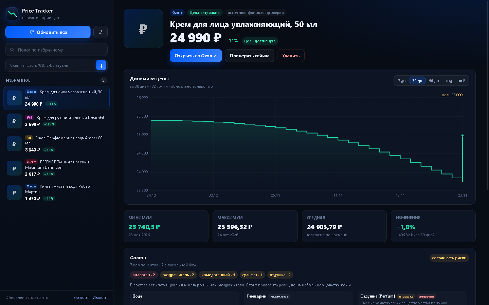
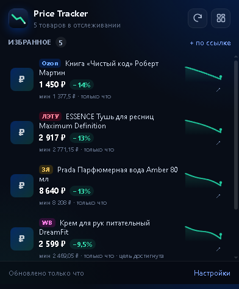
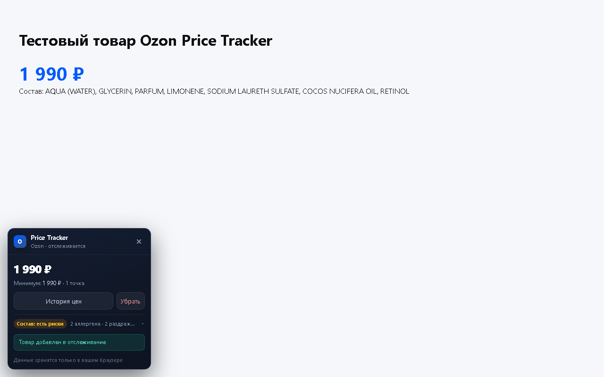

# Price Tracker — Ozon, Wildberries, Золотое яблоко, Летуаль

Расширение для Chromium-браузеров (Google Chrome, Opera), которое следит за историей цен на товары в четырёх магазинах: показывает минимум и максимум, строит график, уведомляет о снижении и достижении целевой цены. Для косметики дополнительно разбирает состав (INCI) и отмечает потенциальные аллергены и раздражители.

Поддерживаемые магазины:

- **Ozon** — `ozon.ru`
- **Wildberries** — `wildberries.ru`
- **Золотое яблоко** — `goldapple.ru`
- **Летуаль** — `letu.ru`

Всё хранится локально в браузере — без аккаунта, серверов и телеметрии.

Текущая версия — `2.2.0`, база ингредиентов — `2026.11`. Скриншоты в `docs/screenshots/` сняты с этой версии.



## Возможности

- **Плашка на карточке товара.** На странице товара любого из четырёх магазинов появляется компактная панель с текущей ценой, бейджем магазина и кнопкой «Отслеживать цену».
- **Список избранного в popup.** Цены, изменение за всё время, минимум и спарклайн по каждому товару; бейдж магазина помогает не путать источники.
- **Панель истории.** Полноценный график за 7 / 30 / 90 дней, год или всё время, статистика (минимум, максимум, средневзвешенная цена, изменение), управление целевой ценой.
- **Разбор состава (INCI).** Для косметики сохраняется состав и локально отмечаются аллергены, раздражители, комедогенные и спорные компоненты. Краткий вердикт виден в плашке, полный разбор — в панели истории.
- **Автоматические проверки.** От 15 минут до раза в день. При снижении цены или достижении цели — уведомление браузера.
- **Добавление по ссылке.** Можно вставить ссылку на товар в popup или на панели, не открывая карточку. Ozon-ссылки вида `ozon.ru/t/...` распознаются автоматически.
- **Экспорт и импорт.** JSON-файл со всеми товарами, историей и настройками; импорт с объединением или заменой. Старые экспорты Ozon-версии импортируются.
- **Тёмная тема**, адаптивная вёрстка, интерфейс на русском.





На плашке виден краткий вердикт по составу, а в панели истории — полный список компонентов с флагами и пояснениями.

## Установка

Расширение устанавливается как распакованное (unpacked). Магазины приложений не используются.

### Google Chrome

1. Откройте `chrome://extensions/`.
2. Включите **Режим разработчика** (Developer mode) справа сверху.
3. Нажмите **Загрузить распакованное расширение** (Load unpacked).
4. Выберите папку `ozon-price-tracker` (ту, где лежит `manifest.json`).
5. Закрепите иконку расширения на панели инструментов.

### Opera

1. Откройте `opera://extensions/`.
2. Включите **Режим разработчика**.
3. Нажмите **Загрузить распакованное расширение** и выберите папку проекта.

После обновления файлов нажмите кнопку обновления у расширения на странице `chrome://extensions/` / `opera://extensions/`.

> Требуется Chromium 102+ (актуальные Chrome и Opera; Manifest V3, module service worker). Проверено на Chrome 157.

## Как пользоваться

1. Откройте карточку товара в Ozon, Wildberries, Золотом яблоке или Летуаль.
2. На плашке в левом нижнем углу нажмите **«Отслеживать цену»**.
3. Откройте popup, чтобы увидеть список, или **«История цен»** на плашке — откроется панель.
4. На панели можно задать целевую цену: когда товар подешевеет до неё, придёт уведомление.
5. В настройках (шестерёнка на панели) выбираются интервал проверок, порог уведомления о снижении, лимит истории и режим обновления через вкладку.

### Обновление цен

Расширение само выбирает способ проверки под каждый магазин:

- **Ozon** — фоновый `fetch` страницы товара с cookies. Цена ищется в JSON-LD, мета-тегах, встроенных данных, затем в DOM. Если Ozon отвечает антибот-защитой, используется запасной путь через неактивную вкладку.
- **Wildberries** — сначала публичный API `card.wb.ru/cards/v2/detail`. Цены в ответе приходят в копейках и переводятся в рубли. Если API недоступен, цена читается со страницы в неактивной вкладке.
- **Золотое яблоко** — только через неактивную вкладку: фоновые запросы получают страницу проверки устройства (`Gold Apple — checking device`).
- **Летуаль** — только через неактивную вкладку: карточка собирается JavaScript'ом, и в фоновом HTML цены нет.

Для режима через вкладку расширение открывает карточку в неактивной (фоновой) вкладке, приглушает звук, ждёт появления цены до 45 секунд и закрывает вкладку. Режим **«Обновлять через вкладку»** включён по умолчанию; его можно отключить в настройках, если не хотите фоновых вкладок.

### Анализ состава (INCI)

Если на карточке есть состав, расширение сохраняет его вместе с товаром и разбирает локально:

- **Флаги:** аллергены, раздражители, комедогенные компоненты, отдушки, сульфаты, спирт, консерванты, фототоксичные компоненты и спорные ингредиенты.
- **Краткий вердикт в плашке:** «спокойный», «есть нюансы», «есть риски», «много рисков», рядом — число аллергенов и раздражителей.
- **Полный разбор в панели истории:** список компонентов, русские названия, теги и пояснения.

Как ищется состав:

- **Ozon и Wildberries** — в описании или характеристиках товара, если он там опубликован.
- **Золотое яблоко** — в блоке состава на карточке.
- **Летуаль** — состав подгружается после раскрытия вкладки, поэтому в плашке есть кнопка **«Разобрать состав»**.

База ингредиентов встроена в расширение (`src/data/inci-db.js`) и работает полностью офлайн: состав не отправляется во внешние сервисы. Редкие компоненты остаются в списке без оценки — это справочная информация, а не медицинская рекомендация.

Что внутри базы (800+ записей, версия `2026.11`):

- **Категории:** основа и растворители, эстеры и масла, воски, силиконы, ПАВ и мыло, эмульгаторы, кондиционеры для волос, загустители и полимеры, увлажнители, активы и пептиды, церамиды, растительные экстракты, консерванты, UV-фильтры, ароматы и аллергены, пигменты, компоненты зубных паст, антиперспирантов и красителей для волос.
- **Русские синонимы:** «вода», «глицерин», «отдушка», «масло ши», «диоксид титана» и ещё 150 названий — встречаются, когда магазин публикует состав по-русски, а не в INCI.
- **Правила семейств:** `PEG-32`, `CETEARETH-20`, `POLYQUATERNIUM-10`, любой номер `CI 12345`, а также типовые хвосты «… extract», «… oil», «… gum», «… protein» распознаются без перечисления каждого производного.
- **Устойчивость к написанию:** `CI15850` и `CI 15850`, `PEG 32` и `PEG-32`, `AQUA/WATER/EAU`, `GLYCERIN & WATER`, запятая внутри названия (`1,2-HEXANEDIOL`) разбираются как один компонент.

Оценка состава опирается только на локальную базу: она не заменяет консультацию врача или дерматолога.

## Приватность и разрешения

- `storage`, `unlimitedStorage` — товары, история цен и настройки в `chrome.storage.local`.
- `alarms` — периодические проверки цен.
- `notifications` — уведомления о снижении и достижении цели.
- `tabs`, `scripting` — обновление через неактивную вкладку и открытие панели.
- `host_permissions` — чтение страниц товаров и запросы цен: `ozon.ru`, `wildberries.ru`, `goldapple.ru`, `letu.ru`, а также API `card.wb.ru`.

Никакие данные не отправляются разработчику или третьим лицам. Сетевые запросы идут только к перечисленным магазинам при проверке цен. Состав косметики хранится в `chrome.storage.local` и анализируется встроенной базой прямо в браузере, без внешних API. Экспортированный JSON содержит историю цен, названия товаров и сохранённый состав — храните его самостоятельно.

## Ограничения

- Цена и наличие определяются по разметке магазинов; при существенном изменении вёрстки селекторы могут потребовать обновления.
- Wildberries, Золотое яблоко и Летуаль не отдают цену фоновому запросу. Для них нужен режим обновления через вкладку — он включён по умолчанию.
- Золотое яблоко может показывать страницу проверки устройства даже в обычном браузере. В этом случае цена обновится, когда карточка загрузится полностью.
- Фоновые вкладки появляются в панели вкладок (без фокуса и звука) и закрываются после проверки. При большом списке проверка может занимать заметное время.
- Браузер должен быть запущен: `chrome.alarms` не работают при полностью закрытом браузере.
- Уведомления зависят от системных настроек и разрешения браузера.
- Разбор состава опирается на локальную базу популярных INCI: редкие компоненты могут остаться без тегов и пояснений.
- Состав есть не на всех карточках; для Летуаль его нужно раскрыть кнопкой «Разобрать состав». Оценка состава не заменяет консультацию врача или дерматолога.
- Расширение не связано с магазинами и не является их официальным клиентом.

## Структура проекта

```
manifest.json          манифест MV3
src/background.js      service worker: хранилище, проверки, уведомления, экспорт/импорт
src/content.js         плашка на странице товара, извлечение цены и состава из DOM
src/popup.*            popup со списком избранного
src/dashboard.*        панель истории, график и настройки
src/lib/stores.js      реестр магазинов: URL, артикулы, бейджи
src/lib/parse.js       разбор ссылок, HTML, JSON-LD и API Wildberries
src/lib/shared.js      модель товара, статистика, форматирование, настройки
src/lib/inci.js        разбор состава, флаги и вердикт
src/data/inci-db.js    база ингредиентов: INCI, русские синонимы, правила семейств
icons/                 иконки 16–128 px
tests/                 unit- и UI-тесты (включая проверку целостности базы)
```

Идентификатор товара — `<магазин>-<артикул>`, например `ozon-1234567890`, `wb-14890618`, `goldapple-80790100005`, `letu-153801007`. Старые записи Ozon без поля `store` мигрируют автоматически.

История хранится в виде точек `{ t: timestamp, p: price, s: 1|0 }`; новая точка добавляется только при изменении цены или наличия.

## Разработка и тесты

```powershell
# unit-тесты парсинга, модели данных, разбора состава и целостности базы (48 тестов)
node --test tests/parse.test.mjs tests/inci.test.mjs tests/inci-db.test.mjs

# UI- и e2e-проверка в headless Chrome:
# загрузка расширения, демо-данные, скриншоты, плашки на подставных
# страницах Ozon, Wildberries, Золотого яблока и Летуаль
node tests/ui-smoke.mjs
```

`tests/ui-smoke.mjs` требует Chrome 137+ с поддержкой `--enable-unsafe-extension-debugging` и CDP `Extensions.loadUnpacked`. Путь к Chrome можно переопределить переменной `CHROME_PATH`. Скриншоты сохраняются в `tests/out/`.

Экспорт из панели создаёт JSON вида:

```json
{
  "app": "price-tracker",
  "version": 2,
  "exportedAt": "2026-11-19T00:00:00.000Z",
  "settings": { "intervalMinutes": 360, "notifyOnDrop": true, "tabFallback": true },
  "items": [
    {
      "id": "wb-14890618",
      "store": "wb",
      "url": "https://www.wildberries.ru/catalog/14890618/detail.aspx",
      "title": "Название товара",
      "price": 2599,
      "targetPrice": 3000,
      "composition": "AQUA, GLYCERIN, PARFUM, LIMONENE",
      "history": [{ "t": 1763500000000, "p": 2599, "s": 1 }]
    }
  ]
}
```

## Лицензия

Проект предоставляется как есть, без гарантий. Используйте на свой риск и соблюдайте условия использования магазинов.
